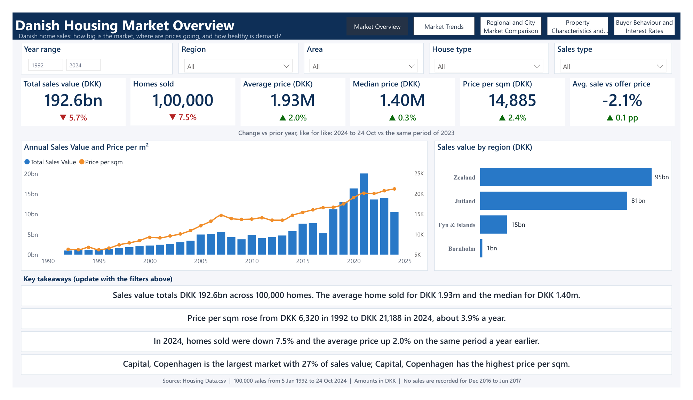
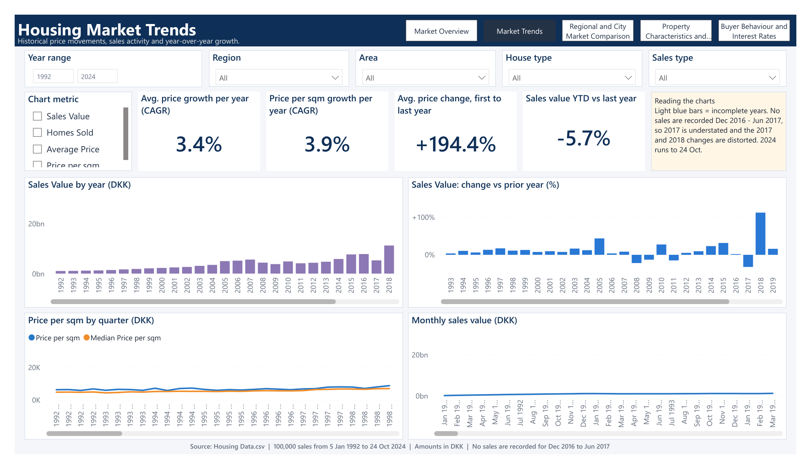
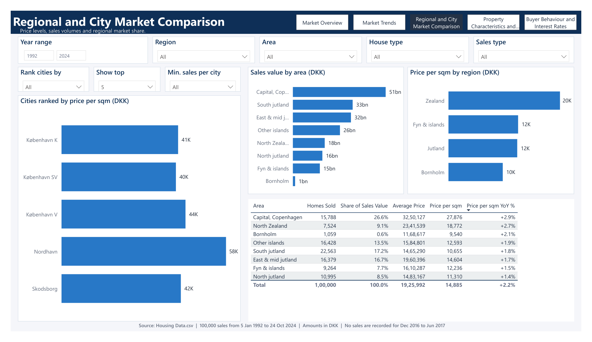
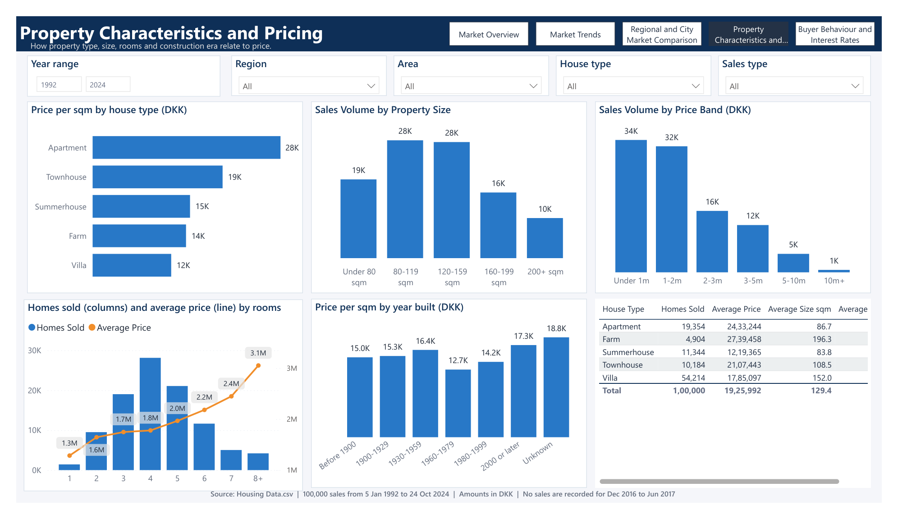
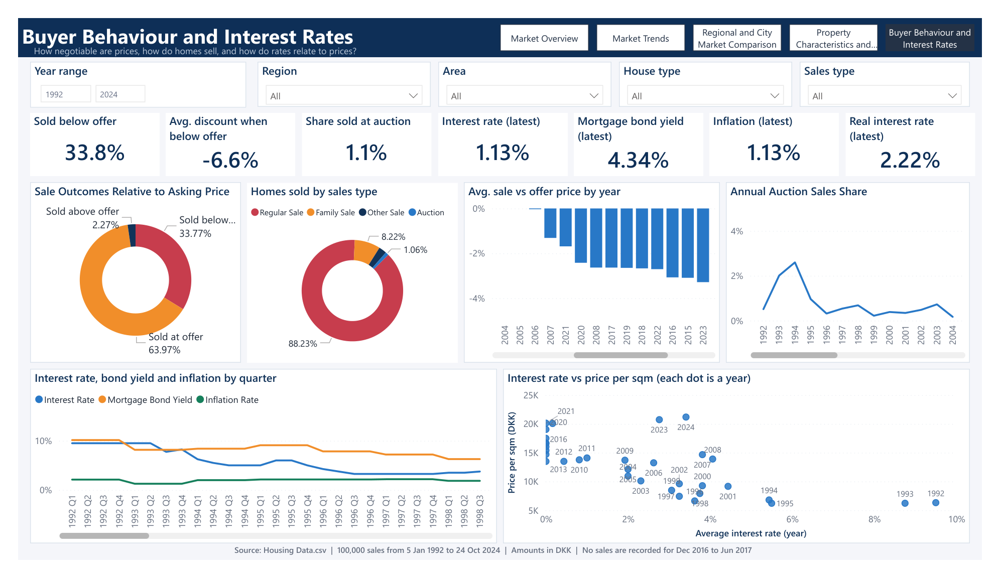

<div align="center">

# 🇩🇰 Danish Housing Market Analysis

### An interactive Power BI report exploring 100,000 Danish residential property sales

**Market overview · Price trends · Regional comparisons · Property insights · Buyer behaviour**


*Portfolio project focused on turning housing transaction data into an interactive, decision-oriented report.*

</div>

---

## 📌 Project at a glance

This project analyses Danish housing transactions to explore how sale values and prices have changed over time, how markets differ by region and city, how property characteristics relate to pricing, and how sale outcomes compare with asking prices and interest-rate indicators.

The report contains five pages with shared filters for year range, region, area, house type and sales type. It is built with **Power BI Desktop**, **Power Query (M)** and **DAX**, using a Power BI Project (`.pbip`) structure that is suitable for version control.

> **Dataset coverage:** 100,000 transactions, from **5 January 1992 to 24 October 2024**. Amounts are presented in Danish kroner (DKK).

## 🖼️ Report preview

### 1. Market Overview


**Purpose:** Answer the big-picture questions: how large is the market, what are typical sale prices, and how does current-period activity compare with the previous year?

**What it includes**
- KPI cards for total sales value, homes sold, average price, median price, price per square metre and average sale-versus-offer price.
- Annual sales value and price-per-square-metre trends.
- Sales value by region.
- Filter-aware key takeaways to summarise the selected market.

**Example reading from the supplied report:** total sales value is shown as DKK 192.6bn across 100,000 homes. The report labels 2024 comparisons as year-to-date through 24 October, compared with the same period in 2023.

### 2. Market Trends


**Purpose:** Explore the evolution of sales activity and prices over time, including growth measures and period-to-period changes.

**What it includes**
- A metric selector for sales value, homes sold, average price and price per square metre.
- Annual sales-value and year-over-year change charts.
- Quarterly price-per-square-metre trends, including average and median values.
- Monthly sales-value trends and summary growth KPIs.
- A data-reading note for incomplete or distorted periods.

**Interpretation note:** the source records no sales from **December 2016 through June 2017**. The supplied report warns that 2017 is understated and 2017–2018 changes may be distorted. The 2024 period is partial.

### 3. Regional and City Market Comparison


**Purpose:** Compare geography to identify where transaction value, sale prices and sales volumes are concentrated.

**What it includes**
- A configurable city ranking by selected measure.
- Controls for the number of cities displayed and minimum sales per city.
- Sales value by area and price per square metre by region.
- A summary table with homes sold, share of sales value, average price and price-per-square-metre year-over-year change.

**Questions it helps investigate:** Which areas account for the most sales value? Where are prices per square metre highest? Do high-price locations also have high transaction volumes?

### 4. Property Characteristics and Pricing


**Purpose:** Understand how housing type, property size, number of rooms and construction era relate to transaction prices and sales volume.

**What it includes**
- Price per square metre by house type.
- Sales volume by property-size band and price band.
- Homes sold and average price by number of rooms.
- Price per square metre by year built.
- A house-type comparison table with sales volume, average price and average size.

**Questions it helps investigate:** Which property types command higher prices per square metre? Which sizes and price bands are most common? How do room count and construction period relate to pricing?

### 5. Buyer Behaviour and Interest Rates


**Purpose:** Examine how negotiated sale prices compare with asking prices and explore how interest-rate indicators move alongside housing prices.

**What it includes**
- KPI cards for homes sold below asking price, average discount when sold below offer, auction share, interest rate, mortgage bond yield, inflation and real interest rate.
- Sale outcomes relative to asking price.
- Homes sold by sales type.
- Average sale-versus-offer price by year and annual auction share.
- Quarterly interest-rate, mortgage-bond-yield and inflation trends.
- A scatter plot comparing average annual interest rate with price per square metre.

**Interpretation note:** the interest-rate and price charts are descriptive comparisons; they do not establish that one variable caused another.

---

## 📊 Questions explored

- How have total sales value, transaction counts and housing prices changed since 1992?
- How do average price and price per square metre differ across regions, areas and cities?
- Which property types, size bands and price bands account for the most transactions?
- How often do properties sell above, at or below their asking price?
- How do interest rates, mortgage bond yields and inflation move alongside housing prices?

## 🧰 Tools and techniques

| Tool | Role in the project |
|---|---|
| **Power BI Desktop / PBIP** | Report pages, interactive filters, visuals and project structure |
| **Power Query (M)** | Importing and shaping the CSV data |
| **DAX** | Measures, calculated tables, time-based comparisons, KPI logic and rankings |
| **Python (pandas)** | Reproducible data-quality checks and summary tables for cross-checking report findings |
| **SQL (SQLite-compatible)** | Focused queries for KPIs, annual trends, region/type comparisons, asking-price outcomes and missing macroeconomic data |
| **CSV** | Transaction-level housing data |
| **Git / GitHub** | Version control and project documentation |

## 📁 Repository structure

```text
Danish-Housing-Market-Analysis/
├── Housing Market Report.pbip
├── Housing Market Report.Report/
│   └── ... report pages, visuals and theme
├── Housing Market Report.SemanticModel/
│   └── ... model, relationships, expressions and DAX tables
├── data/
│   └── Housing Data.csv
├── screenshots/
│   ├── 01-market-overview.png
│   ├── 02-market-trends.png
│   ├── 03-regional-city-comparison.png
│   ├── 04-property-characteristics.png
│   └── 05-buyer-behaviour-interest-rates.png
├── docs/
│   └── Housing Market Report.pdf
├── analysis/
│   ├── python/
│   │   └── analyze_housing.py
│   └── sql/
│       └── housing_analysis.sql
├── Powerbi_reference/
│   ├── 1_PowerQuery_Housing_Data.m
│   ├── 2_Calculated_Tables.dax
│   └── 3_Measures.dax
├── .gitignore
└── README.md
```

## 🚀 Open the report

### Requirements
- Windows with a recent version of **Power BI Desktop**.
- The repository files, including the CSV under `data/`.

### Steps
1. Clone or download this repository and extract it.
2. Open `Housing Market Report.pbip` in Power BI Desktop.
3. If Power BI reports that the CSV cannot be found, go to **Home → Transform data → Edit parameters**.
4. Set the `CsvPath` parameter to the full path of the CSV inside your extracted repository, for example:

   ```text
   C:\path\to\Danish-Housing-Market-Analysis\data\Housing Data.csv
   ```

5. Confirm the parameter, select **Close & Apply**, and allow the model to refresh.
6. Check all five pages and save the project.

## 🐍 Python and 🗄️ SQL analysis

The repository includes a small, purposeful analysis layer to support and cross-check the Power BI report—not a second, oversized analytics project.

### Python (pandas)

[`analysis/python/analyze_housing.py`](analysis/python/analyze_housing.py) checks the dataset coverage and missing values, calculates overall market KPIs, creates annual trends, compares regions and property types, and summarises sale outcomes against asking prices. It writes CSV summaries to `analysis/outputs/` when run.

**Run from the repository root:**

```bash
python -m pip install pandas
python analysis/python/analyze_housing.py
```

### SQL (SQLite-compatible)

[`analysis/sql/housing_analysis.sql`](analysis/sql/housing_analysis.sql) contains seven focused queries covering data quality, market KPIs, annual trends, regional comparisons, house types, asking-price outcomes and missing interest-rate/inflation fields. The queries expect the CSV to be imported into a SQLite table named `housing_data`, with the original column names preserved.

For example, using the SQLite command-line shell:

```sql
.mode csv
.import --skip 1 data/Housing\ Data.csv housing_data
.read analysis/sql/housing_analysis.sql
```

If your SQLite version does not support `--skip 1`, create the table/import using a GUI such as DB Browser for SQLite and enable the option to use the first CSV row as column names. Because the source includes punctuation in some column names, keep the original headers unchanged.

**Interpretation:** the scripts preserve source values and do not claim causal relationships. Treat year-over-year changes around the Dec 2016–Jun 2017 data gap carefully, and interpret 2024 as a partial year through 24 October.

> **PBIP or PBIX?** The repository keeps PBIP as the main project because its report and model definitions are easier to track in Git. A PBIX can optionally be saved from Power BI Desktop after the report has been opened, refreshed and checked successfully.

## 🗃️ Dataset and data quality notes

- The included CSV contains **100,000 rows** and 19 columns covering transaction date, property type, sales type, build year, purchase price, offer-to-purchase change, rooms, floor area, price per square metre, location and interest-rate / inflation fields.
- Coverage: **5 January 1992–24 October 2024**.
- Currency: **DKK**.
- The final year is incomplete; comparisons for 2024 should use the same-period comparison described in the report.
- No sales are recorded from **December 2016 to June 2017**, which affects interpretation of 2017 and 2018 trends.
- Some macroeconomic fields contain missing values, especially near the end of the dataset. Check completeness before using those fields for new calculations.
- The PDF and screenshots in this repository are exports supplied for project documentation; refresh and review the live PBIP report before treating the visuals or figures as a current result.

### Data permission
The dataset was supplied for inclusion in this project. Before making the repository public, confirm that you have the right to redistribute the CSV and any underlying source data. If the dataset is licensed or restricted, remove it from the public repository and document how users can obtain it legally.

## 🔍 Reproducibility checklist

- [ ] Open the `.pbip` file in Power BI Desktop.
- [ ] Set `CsvPath` to the included CSV file.
- [ ] Refresh the model without errors.
- [ ] Verify all five pages and check for blank visuals.
- [ ] Review key measures and time comparisons.
- [ ] Confirm data redistribution permission before publishing publicly.

## 📄 Included report export

A five-page PDF export is available at [`docs/Housing Market Report.pdf`](docs/Housing%20Market%20Report.pdf).

---

<div align="center">

**Built with Power BI · Power Query · DAX**

*An analytical portfolio project about the Danish housing market.*

</div>
